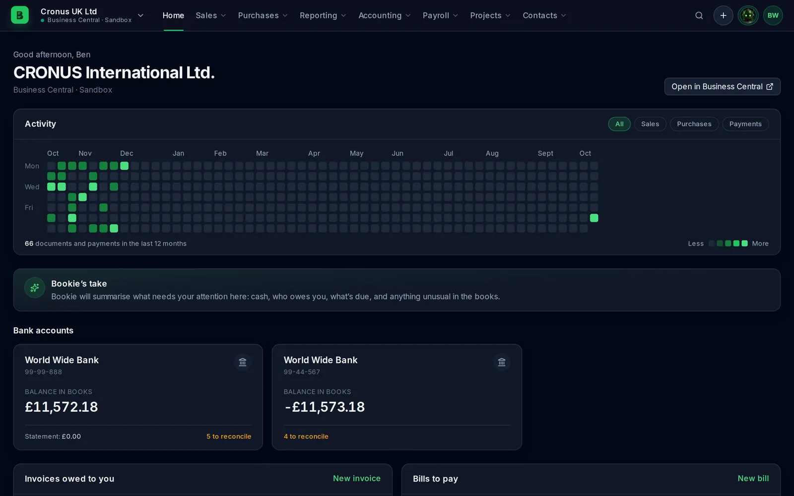
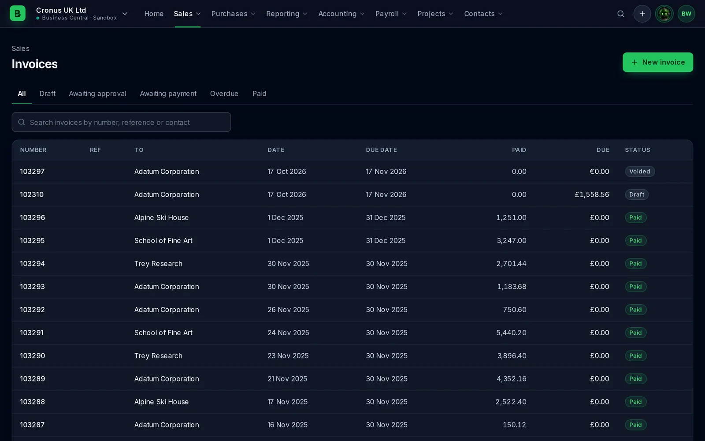
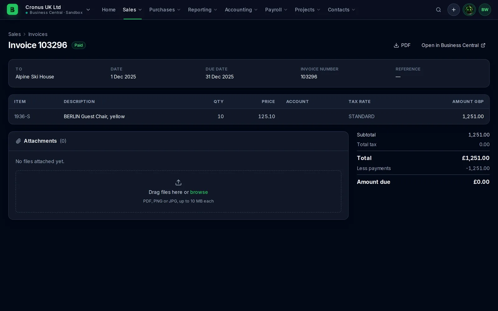
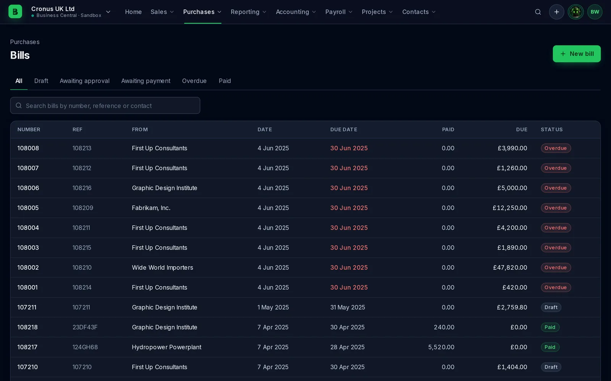
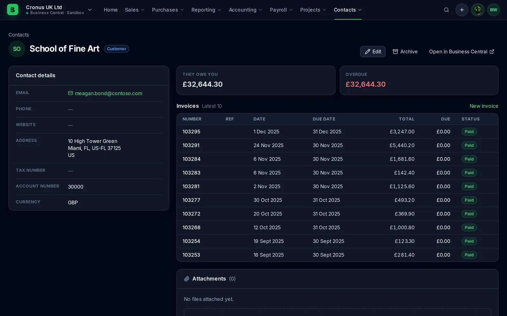
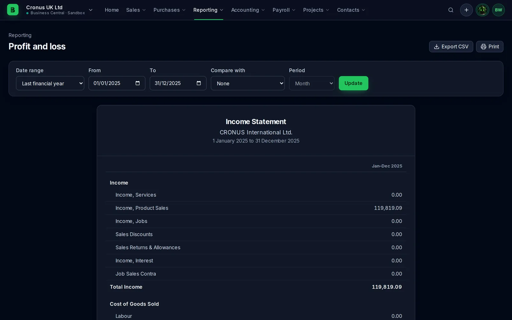
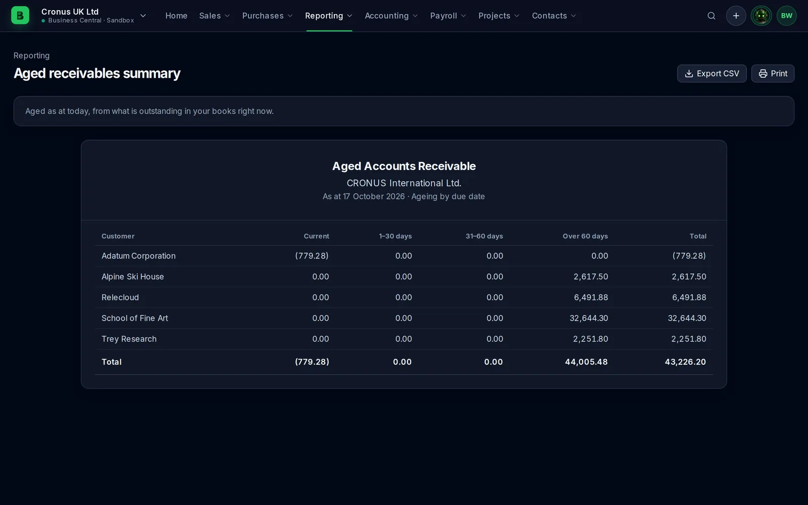
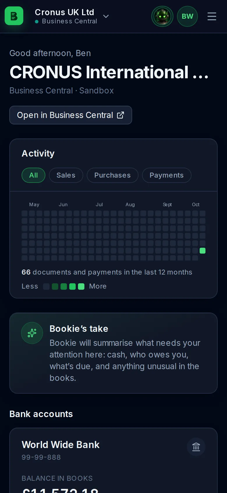
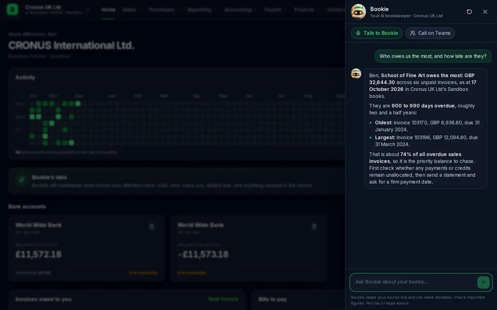

<p align="center">
  
</p>

<h1 align="center">Bookie</h1>

<p align="center">
  <strong>Clear books, and a bookkeeper who never clocks off.</strong><br>
  A familiar, Xero-style portal over <strong>Xero</strong> or <strong>Microsoft Dynamics 365 Business Central</strong>, with Bookie the AI bookkeeper built in.
</p>

<p align="center">
  <a href="https://getbook.ie">getbook.ie</a> ·
  <a href="docs/SOLUTION_DESIGN.adoc">Solution design</a> ·
  <a href="docs/AGENT.adoc">Bookie agent</a> ·
  <a href="docs/DEPLOYMENT.adoc">Deployment</a> ·
  <a href="CONTRIBUTING.md">Contributing</a>
</p>

<p align="center">
  <a href="https://github.com/knowall-ai/bookie/actions/workflows/ci.yml"></a>
  <a href="https://coderabbit.ai"></a>
  
</p>

---

Bookie is **free and open source** from [KnowAll AI](https://knowall.ai), a sibling of [Thyme](https://github.com/knowall-ai/thyme) (Harvest-style time tracking on Business Central) and [ZapDesk](https://github.com/knowall-ai/zapdesk) (Zendesk-style support on Azure DevOps and GitHub).

## Screenshots

Real pages, read live through Bookie's own connector code from **Microsoft's CRONUS sample company** in a Business Central sandbox. No client data, and nothing made up. More in [docs/images/screenshots](docs/images/screenshots).

| | |
|---|---|
|  |  |
| **Home:** activity chart, bank accounts, what you're owed and what you owe | **Sales › Invoices:** Xero's status tabs, search, paid and due |
|  |  |
| **Invoice:** lines, totals, payments, PDF and attachments | **Purchases › Bills:** overdue, draft and paid at a glance |
|  |  |
| **Contact:** what they owe, what's overdue, latest invoices | **Profit and loss:** any period, comparisons, CSV export and print |
|  |  |
| **Aged receivables:** who owes what, by how overdue | **On a phone:** every page is responsive |

**Ask Bookie**, with his real answer to "Who owes us the most, and how late are they?" on CRONUS:



## Features

**A portal that feels like Xero.** Home, Sales, Purchases, Reporting, Accounting, Payroll, Projects and Contacts, with Xero's vocabulary, status tabs and layouts, in the KnowAll dark theme. Responsive down to a phone.

- **Home:** a year of organisation activity as a heatmap (sales, purchases and payments), bank accounts, invoices owed to you, bills to pay, and profit and loss.
- **Sales:** invoices (with history and notes, mark as sent, and Xero's online invoice link), quotes (draft, mark sent, accepted or declined, convert to an invoice), credit notes (create, approve, allocate to invoices), and products and services.
- **Purchases:** bills (pay several at once as a batch payment), purchase orders (with Xero's status flow), supplier credit notes, and the **Inbox** of documents waiting to become bills. Bills drafted by the Bookie agent show under **Captured by Bookie**.
- **Attachments:** upload and view files on invoices, bills and contacts.
- **Accounting:** bank accounts with a full register and transfers between accounts, chart of accounts, manual journals (post, void, reverse), payments (recording a payment against an invoice), fixed assets, tax rates and organisation settings.
- **Reporting:** profit and loss, balance sheet, trial balance, cash flow, aged receivables and payables, account transactions and journal reports, with comparison periods, **CSV export** and print. A report the source system can't provide says so instead of guessing.
- **Contacts and search:** customers and suppliers with balances and history, and a global search across the organisation.
- **Payroll and Projects:** employees, pay runs and projects where the source system has them.

- **Multi-currency:** documents and payments in any currency the organisation uses. Totals across documents are kept per currency ("£8,340.00 + €1,200.00"), never converted at a guessed rate; a document's own base-currency total uses the source's rate for it.
- **Live feed:** a Live panel on Home shows invoices, bills and contacts changing as it happens, from Xero and Business Central webhooks.
- **Bitcoin wallets:** add a wallet's xpub or output descriptor (single-key, Taproot or multisig) and it appears under Bank accounts, read live from an Electrum server, valued in the organisation's base currency (GBP, USD, EUR...) at the Kraken price at each transaction's own time, labelled with its source, and reconciled against its Business Central bank account in BTC (exact on txid and sats; draft journal lines, post after you confirm). Watch-only: Bookie never holds a key that can spend. See [docs/BITCOIN.adoc](docs/BITCOIN.adoc).

**Xero or Business Central, same screens.** Each organisation can live in either system. Turn each connector on or off in Settings.

- **Xero:** connect with "Connect to Xero" (OAuth 2.0, many organisations in one go) or paste Custom Connection keys. Add as many as you like.
- **Business Central:** found automatically with your own Microsoft sign-in and permissions, across every environment and company you can reach. The optional [Bookie BC extension](bc-extension) fills gaps in BC's standard API (bank balances and transactions, amounts due on bills, posted payments, recording customer payments).
- **More to come:** connectors are a defined interface, so full Dynamics 365 Finance or a ledger kept in your own SharePoint can be added without touching the screens.

**Built for accountants.** Every organisation you can reach appears in one switcher. Move between clients' books in a click; there is no blending of one client's data with another's.

**Full read and write.** Draft, approve, email and void invoices and bills; quotes, purchase orders, contacts, payments, bank transactions and manual journals. Anything that posts to the books asks you to confirm first.


**Bookie, the AI bookkeeper.** Meet him in his [30-second introduction](https://getbook.ie/#bookie).

- **In the portal:** ask him anything about the open organisation ("who owes us the most?"). He looks it up live with read-only tools and explains it. **Bookie's take** on the Home page gives three live points worth your attention (hidden when Bookie isn't configured).
- **By voice:** talk to him in the browser, or **Call on Teams** from the Ask Bookie panel.
- **As a Hermes agent:** he has his own Microsoft 365 account, joins Teams calls with [Agent Presence](https://github.com/knowall-ai/agent-presence) using **GPT-Live-1**, and remembers people and context with [Reverie](https://github.com/knowall-ai/hermes-reverie). See [agent/](agent).
- **Bill capture (in progress):** the agent reads supplier invoices sent to a shared accounts mailbox and turns them into **draft** bills (never approved or paid without a person), leaving anything it can't read with confidence blank and flagged for review.

**Your data stays yours.**

- **Nothing stored:** Bookie never stores your accounts; it reads Xero and Business Central live.
- **Settings in your own tenant:** the only thing it keeps is your connection settings, encrypted with a per-organisation key and stored in your own Microsoft 365 (a hidden SharePoint list).
- **No AI training:** data from Xero is never used to train AI.

## How it fits together

```
 Browser ──► getbook.ie (Next.js on Azure App Service)
               │  Microsoft Entra sign-in (multi-tenant)
               ├─► Xero API                (OAuth or Custom Connection, per organisation)
               ├─► Business Central API    (as the signed-in user)
               ├─► SharePoint (your tenant) sealed connection settings, never accounts
               └─► Azure OpenAI            Bookie chat and voice (no training on your data)

 Teams ──► Bookie agent (Hermes on his own Azure VM)
               ├─ Agent Presence: Teams calls, GPT-Live-1 voice, avatar
               ├─ Reverie: memory of people and conversations (no ledger data)
               └─ Xero skill + Business Central MCP
```

## Repository layout

| Folder | What |
|---|---|
| [`web/`](web) | The website and portal (Next.js 16, Bun, Tailwind 4, TypeScript) |
| [`bc-extension/`](bc-extension) | Optional Business Central extension (AL) adding the API Bookie needs beyond BC's API v2.0 |
| [`bc-extension-bitcoin/`](bc-extension-bitcoin) | Optional Business Central extension (AL) that keeps a Bitcoin wallet's descriptor on a bank account ([docs/BITCOIN.adoc](docs/BITCOIN.adoc)) |
| [`agent/`](agent) | Bookie the Hermes agent: identity, skills, voice, memory, VM deployment |
| [`infra/`](infra) | Azure deployment for the web app (App Service, Key Vault, Azure OpenAI) |
| [`docs/`](docs) | Solution design, deployment, testing, security, agent and hosted-agent isolation |

## Quick start

```bash
cd web
bun install
cp .env.example .env.local           # fill in the Entra app and secrets
echo "BOOKIE_DEV_AUTH=demo" > .env.development.local   # fictional demo organisations
bun run dev                           # http://localhost:3103
```

To use real books in development, see [docs/DEPLOYMENT.adoc](docs/DEPLOYMENT.adoc) for the Entra app registration, then remove `BOOKIE_DEV_AUTH` and sign in with Microsoft.

## Checks

```bash
bun run check          # format, lint, typecheck, unit tests, production build
bun run test:coverage  # unit tests with coverage (fails below the thresholds in vitest.config.ts)
bun run test:e2e       # Playwright on the demo organisations, desktop and mobile
bun run parity         # live: Bookie's numbers vs the source system's own reports (no amounts printed)
```

CI runs all of these except `parity` on every pull request (coverage in the job summary, Playwright
for desktop and mobile in parallel), and checks PR titles use a conventional-commit prefix. Pushing
a `v*` tag deploys to production; see [docs/DEPLOYMENT.adoc](docs/DEPLOYMENT.adoc).

## Licence

MIT, see [LICENSE](LICENSE). "Bookie" and the Bookie character are trademarks of KnowAll AI Ltd; see [TRADEMARKS.md](TRADEMARKS.md). Not affiliated with Xero or Microsoft.
