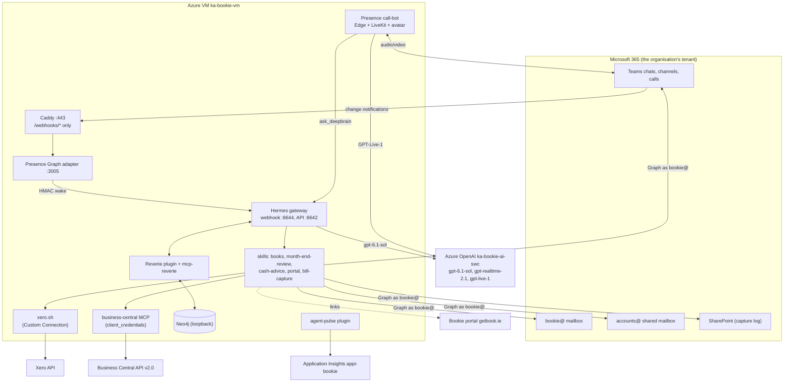

# Bookie, the AI bookkeeper (Hermes agent)

Bookie is the bookkeeper of the [Bookie portal](https://getbook.ie) in person: a
[Hermes Agent](https://hermes-agent.nousresearch.com) (Nous Research) on his own Azure Linux VM, with
his own Microsoft 365 account. People message him in Teams, email him, or invite him to a Teams call,
where he joins with a voice (GPT-Live-1) and a robot avatar through
[Agent Presence](https://github.com/knowall-ai/agent-presence). He answers questions about the books in
**Xero** and **Microsoft Dynamics 365 Business Central**, live, gives practical bookkeeping advice,
runs a month-end review, and captures supplier bills from the shared accounts mailbox as drafts.

He is deployed exactly like Poppie (`knowall-ai/poppie-hermes`): same VM shape, same Presence media
plane, same Reverie memory, same agent-pulse telemetry. Only his identity, skills and access differ.

| | KnowAll's install | A customer's self-hosted install |
|---|---|---|
| Identity | `bookie@knowall.ai` | `bookie@<their-domain>` (`AGENT_UPN`) |
| Azure | `ka-bookie-prod` / `ka-bookie-vm` (uksouth), `ka-bookie-ai-swc` (swedencentral) | their own subscription, any names |
| Books | KnowAll AI Ltd (Xero + BC), KnowAll AI SAS de CV (BC) | their organisations (`ORGANISATIONS`) |

## Contents

```
agent/
├── README.md                       # this file
├── hermes/
│   ├── SOUL.md                     # identity and rules ({{AGENT_UPN}} etc. rendered by step 04)
│   ├── voice_persona.md            # how he speaks on calls (rendered to ~/.hermes/voice_persona.md)
│   └── scripts/                    # skill farm, skills sync, name check, bill-capture gate, Xero attach, accounts@ subscription
├── skills/                         # books, month-end-review, cash-advice, portal, bill-capture, bitcoin
├── config/
│   ├── hermes/config.yaml.template # brain, memory, skills dirs, MCP servers, webhook routes, plugins
│   ├── hermes/env.example          # every ~/.hermes/.env variable, no values
│   ├── presence/call-bot.env.example   # Presence call-bot: GPT-Live-1 on Azure, avatar, brain seam
│   ├── systemd/                    # hermes-gateway, skills-sync, renew-subscriptions timer, accounts-subscription
│   └── caddy/Caddyfile.template    # only /webhooks/* is public
├── assets/bookie-avatar.json           # identity data for the Presence renderer (eyes, visor; plates beside it)
└── deploy/                         # numbered, idempotent provisioning scripts + deploy-all.sh
```

## Architecture



Two seams connect Presence to the brain, as for every KnowAll agent: the signed **wake** webhook
(Graph adapter and call bridge to Hermes routes `graph`, `graph-prep`, `graph-join`) and the
OpenAI-compatible **deep brain** (`ask_deepbrain` to Hermes' API server).

## How Bookie reaches the books

Everything is **read-only by default**, enforced by credentials, not only by instructions.

### Xero

- Through the KnowAll `xero` skill's wrapper `xero.sh` (from the knowall-ai skill pack, linked into the
  de-duplicated farm): client_credentials token, tenant id and caching per organisation.
- One **Custom Connection** per Xero organisation (developer.xero.com, "Custom connection"), authorised
  by someone who may connect that organisation. Keys are stored on the VM only, in
  `~/.config/xero/credentials` (and `credentials.<key>` for more), **mode 600**, owner `bookie`, written by
  `deploy/42-install-xero-credentials.sh`, which prompts without echo.
- Scopes: `accounting.settings.read accounting.contacts.read accounting.transactions.read
  accounting.reports.read`. With bill capture also `accounting.transactions accounting.attachments
  accounting.contacts`. Every read requests only the read scopes (`XERO_SCOPE`); writes widen it for one
  step and drop the token afterwards.
- Custom Connections are a paid Xero add-on per organisation and exist for AU/NZ/UK/US organisations
  only. Elsewhere use a standard OAuth 2.0 app (auth code + refresh token); `xero.sh` does not do that
  flow yet (open question).

### Business Central: a service-to-service Entra app

Bookie signs in to BC as an application (OAuth 2.0 client_credentials) with his own Entra app
registration, never as a person, so nothing depends on someone's `az login`. The MCP server is
`@knowall-ai/mcp-business-central` with `BC_AUTH_TYPE=client_credentials`, one server per BC company
(`business-central`, `business-central-2`), and Hermes registers only its read tools (`get_schema`,
`list_items`, `get_items_by_field`; plus `create_item`/`update_item` when bill capture is on, never
`delete_item`).

Exact steps:

1. **Entra (tenant admin, workstation):** `./41-install-bc-mcp.sh --local`. It creates the single-tenant
   app **Bookie Business Central**, adds the *Dynamics 365 Business Central* application permission
   `API.ReadWrite.All` and grants admin consent. (The role is what the BC API requires for app-only
   access; what Bookie may do is decided by the BC permission sets in step 3.)
2. **BC (BC admin, in the BC web client):** search **Microsoft Entra Applications**, choose **New**.
   - Client ID: the app id printed in step 1. Description: `BOOKIE AI BOOKKEEPER`. State: **Enabled**
     (BC says a user of that name will be created; application users need no licence).
3. **On that card, User Permission Sets**, with Company blank (all companies) or one line per company:
   - `D365 READ`: always.
   - `D365 PURCH DOC, EDIT` and `D365 VENDOR, EDIT`: only if bill capture drafts BC purchase invoices.
   - Never `D365 BUS FULL ACCESS`, `SUPER`, or a set that posts or approves.
4. **Grant Consent** on the card (sign in as a Global or Application administrator). Check the user is in
   **Users**. Repeat in Sandbox if wanted.
5. **Secret to the VM:** `./41-install-bc-mcp.sh --local --push-secret` creates a one-year client secret
   and pipes it over SSH into `~/.hermes/.env` on the VM (`BC_CLIENT_SECRET`, mode 600), never shown.
   Or create it in the portal and run `./41-install-bc-mcp.sh --vm`, which prompts for it. Diary the expiry.
6. **Smoke test:** `--vm` mints a token and prints how many companies BC shows. Nothing else.

### Demo mode: a fictional company for customer demos

On a call, anyone can say "switch to demo mode". Until the call ends Bookie then works only in a demo
company with fictional data (Microsoft's CRONUS, in a BC Sandbox), may share its figures with everyone
on the call, may draft documents there once someone confirms out loud, and won't touch or mention any
real books, even if asked. Demo mode only narrows what he sees, which is why anyone may switch it on;
it never applies in Teams chats or email.

1. In the **demo environment** (not production), repeat steps 2 to 4 for the same app, with permission
   sets `D365 READ`, `D365 SALES DOC, EDIT`, `D365 PURCH DOC, EDIT`, `D365 CUSTOMER, EDIT`,
   `D365 VENDOR, EDIT`, plus `BOOKIE READ` and `BOOKIE BTC READ` if the Bookie extensions are
   installed there. Never a set that posts.
2. Set `DEMO_BC_ENVIRONMENT`, `DEMO_BC_COMPANY` and `DEMO_ORG_NAME` in `config.env` and re-run step 04.
   It adds the `business-central-demo` MCP server and the demo-mode sections of SOUL.md and the voice
   persona, and refuses a demo environment that is the same as `BC_ENVIRONMENT`.
3. For Bitcoin in the demo, add a bank account with a real watch-only descriptor (a small wallet kept
   for demos) using the Bookie Bitcoin extension, and post its transactions, so the reconcile has real
   chain data to compare. Bookie never shows made-up chain data.

Demo mode is enforced by Bookie's instructions; the real BC servers stay registered during a demo.

## Voice and Teams: Agent Presence with GPT-Live-1

- `deploy/23-setup-call-bot.sh` installs Presence from a **pinned commit** (`PRESENCE_PIN`) of
  `knowall-ai/agent-presence` (clone + rsync, as on Poppie's VM), renders Presence's own systemd units
  (`pulse-setup`, `teams-presence`, `call-bot-bridge`, `call-bot`, `graph-adapter`, `renew-subscriptions`)
  and writes the call-bot `.env` from `config/presence/call-bot.env.example`.
- Voice: `VOICE_REALTIME_PROVIDER=openai-live` (gpt-live-1, full duplex) with `VOICE_LIVE_PROVIDER=azure`:
  `AZURE_LIVE_ENDPOINT`, `AZURE_LIVE_DEPLOYMENT=gpt-live-1`, `AZURE_LIVE_BACKEND_DEPLOYMENT=gpt-6.1-sol`
  (the tool backend must be on the same resource). The VM's managed identity signs in (Cognitive Services
  OpenAI User); a key is only a fallback.
- **Quota:** KnowAll's subscription currently has all its gpt-live-1 quota on another agent's resource.
  Until Bookie's own quota is granted, set `AZURE_LIVE_ENDPOINT` (and `LIVE_RESOURCE_ID`, so step 13 grants
  the VM identity access there) to that resource. His voice is billed there meanwhile. When his quota
  arrives: deploy `gpt-live-1` on `ka-bookie-ai-swc` (step 13 with `AI_LIVE_MODEL_VERSION`), point the
  endpoint back, restart `call-bot-bookie`.
- **Rollback:** `VOICE_REALTIME_PROVIDER=openai` (gpt-realtime-2.1), one line and a restart. Presence
  routes only gpt-live to Azure today, so the rollback is OpenAI direct (`OPENAI_API_KEY`, metered);
  `gpt-realtime-2.1` is already deployed on Bookie's resource for when Presence gains an Azure route.
- Teams presence signs in as `bookie@` in Edge on the VM (`TEAMS_PASSWORD`, TOTP for MFA), so he can be
  invited like a colleague and calls ring him. Calls are restricted to internal users (step 09).

## Memory: Reverie, and what it must never hold

Reverie (`knowall-ai/hermes-reverie` plugin + `@knowall-ai/reverie` MCP server, Neo4j on loopback) recalls
people, organisations, who may see which books, preferences ("Sam wants amounts ex-VAT", "Northwind bills
go to account 429") and what was discussed, before every turn, and consolidates nightly ("Dreaming").

**Rule: Reverie stores conversations, people and preferences, never ledger data copied from Xero or
Business Central**: no amounts, balances, invoice or bill lines, bank lines or report contents. Xero's
developer terms forbid using data from the Xero API to train or fine-tune AI models, and the books are the
source of truth anyway: Bookie asks them again every time. Writes to Reverie go through the plugin's own
tool only (the MCP `reverie` server exposes read tools), and SOUL.md rule 4 plus the `books` skill repeat it.

## Model strategy

| Role | Model | Where | Billing |
|---|---|---|---|
| Brain (chat, email, skills, tools) | `gpt-6.1-sol` | Hermes `azure-foundry` provider on `ka-bookie-ai-swc` (swedencentral) | metered Azure, Bookie's own resource and budget |
| Vision (attachments, shared screens) | `gpt-6.1-sol` | same deployment | same |
| Voice | `gpt-live-1` | Presence `openai-live` + `VOICE_LIVE_PROVIDER=azure` | metered Azure (borrowed resource until quota) |
| Voice tool backend | `gpt-6.1-sol` | `AZURE_LIVE_BACKEND_DEPLOYMENT` on the live resource | same |
| Voice rollback | `gpt-realtime-2.1` | deployed on `ka-bookie-ai-swc`; OpenAI direct until Presence supports it on Azure | metered |
| Fallback | none | a failed call is reported, never answered by a weaker model | |

Each agent bills its own resource, so the Presence spend meter and the Azure budget see exactly Bookie's cost.

## AI services: bill capture from accounts@

Bookie does the AI work for the books; the web portal shows the results. First service: **invoice
recognition** (`skills/bill-capture`).

- **Access to `accounts@`:** `deploy/10-grant-accounts-mailbox.ps1` gives `bookie@` **FullAccess with
  AutoMapping off** (recommended, least privilege: one mailbox by construction, no new secret, actions
  audited as bookie@, no Send As). The documented alternative is an app with application `Mail.ReadWrite`
  restricted to that one mailbox (Exchange RBAC for Applications, or the older ApplicationAccessPolicy;
  `-AppId` mode of the same script). Bookie's Graph app holds the delegated `Mail.ReadWrite.Shared` scope.
- **Wake:** a `bill-capture` hermes cron job behind `accounts-inbox-gate.sh` (lists the Inbox, wakes Bookie
  only for new messages, no model call otherwise). Optional: a Graph change-notification subscription on the
  Inbox (`ACCOUNTS_MAILBOX_WAKE=webhook`, `accounts-subscription.mjs`) for faster wakes.
- **What it does:** vision reads the PDF/image/HTML invoice; picks the organisation from the addressee, VAT
  number and currency (asks when unsure); matches the supplier by VAT number, then name (a new supplier
  waits for a human "approve"); checks duplicates (supplier + number + total, drafts included); checks the
  PO where the organisation uses them; creates a **DRAFT** bill only (Xero ACCPAY DRAFT with the document
  attached; BC draft purchase invoice); replies in Teams with a confidence and a portal link; files the email
  under `Bookie/Processed` or `Bookie/Needs review`; logs every outcome with a reason. **No guessing:** an
  unreadable field stays blank and marks the bill for review.
- **Phase 2 (off):** "approve in Teams" by an authorised approver moves a Xero draft to Awaiting payment,
  with the approver named in the bill history.

## Paid add-on

Bookie the agent is an add-on to the open-source portal. It installs in the **customer's own Azure
subscription and Microsoft 365 tenant**: their VM, their `bookie@<domain>` account, their Azure OpenAI
resource, their Reverie graph, their Xero and BC credentials. KnowAll's data never meets theirs, and theirs
never leaves their tenant except to the model endpoint in their own subscription and to Xero/BC. KnowAll
installs and runs it for KnowAll AI (this configuration) and, as a service, for customers who want that.
A KnowAll-hosted multi-customer offering needs the isolation design in `docs/HOSTED_AGENT_ISOLATION.adoc`.

## Provisioning (in order)

Prerequisites on the workstation: `az` (logged in as a tenant admin with Owner on the subscription),
PowerShell 7 with ExchangeOnlineManagement and MicrosoftTeams (or IPPS) modules, SSH. Fill
`deploy/config.env` from `config.env.example` (`chmod 600`). Exports: `M365_ADMIN_UPN`, `M365_SKU_ID`,
`TENANT_ID`. Every script is idempotent: fix and re-run. `./deploy-all.sh --list` prints this plan.

| # | Where | Command | Human interaction |
|---|---|---|---|
| 1 | local | `./01-create-vm.sh` | |
| 2 | DNS | A record `bookie-agent.knowall.ai` -> VM IP (`bookie.knowall.ai` is the web portal) | DNS admin |
| 3 | local | `./05-create-entra-user.sh` | initial password (prompted) |
| 4 | local | `./06-add-to-ai-agents-group.sh` | Exchange admin sign-in (pwsh) |
| 5 | local | `./07-assign-license.sh --list`, then `./07-assign-license.sh` | **a free licence seat with Teams** |
| 6 | local | `pwsh ./14-email-moderation.ps1`, then `pwsh ./08-restrict-email.ps1` | Exchange admin sign-in. 14 creates Bookie's own moderation rule (switch it with `-Moderation Off\|On`); 08 only checks the rules. The AI Agents catch-all is owned by knowall-ai/sallie deploy/25: run that first (if 14 runs first it only warns) |
| 7 | local | `pwsh ./09-restrict-teams.ps1` (or `-FallbackMessagingPolicy`) | **Teams/Compliance admin PowerShell** |
| 8 | local | `pwsh ./10-grant-accounts-mailbox.ps1` | Exchange admin; then create the two `Bookie/...` folders in accounts@ |
| 9 | local | `./12-lockdown-nsg.sh` | |
| 10 | local | `./13-create-ai-resource.sh` | **gpt-live-1 quota request**; model versions in config.env; budget |
| 11 | local | `./21-setup-graph-webhooks.sh --local` | admin consent |
| 12 | local | `./31-setup-telemetry.sh --azure` | |
| 13 | local | `./41-install-bc-mcp.sh --local` | then **BC UI: Microsoft Entra Applications card, permission sets, Grant Consent** |
| 14 | VM | `git clone https://github.com/knowall-ai/bookie.git ~/bookie`; copy `config.env` to `~/bookie/agent/deploy/` | |
| 15 | VM | `./02-setup-desktop.sh` (reboots) | admin RDP password |
| 16 | VM | `./03-install-software.sh` | |
| 17 | VM | `./25-setup-swap.sh` | |
| 18 | VM | `./04-configure-hermes.sh` | Azure OpenAI key (prompted); deploy key if the skill pack is private |
| 19 | VM | `./11-setup-ssl-proxy.sh` | DNS must already resolve |
| 20 | VM | `./40-install-reverie.sh` | |
| 21 | local | `./41-install-bc-mcp.sh --local --push-secret` (or VM `./41-install-bc-mcp.sh --vm`) | |
| 22 | VM | `./42-install-xero-credentials.sh` | **Xero Custom Connection created and authorised first** |
| 23 | VM | `./23-setup-call-bot.sh` | **deploy key on agent-presence**, `PRESENCE_PIN`, Teams password |
| 24 | VM | `./21-setup-graph-webhooks.sh --vm` (export the three ids step 11 printed) | **device-code sign-in as bookie@ with MFA** |
| 25 | VM | `./31-setup-telemetry.sh --vm` | **deploy key on poppie-hermes** (agent-pulse plugin, `AGENT_PULSE_PLUGIN_REF`) |
| 26 | VM | `./33-setup-skills-sync.sh` | |
| 27 | VM | `sudo systemctl start hermes-gateway-bookie`; restart the Presence units | first Teams sign-in in Edge over RDP |
| 28 | VM | `sudo -u bookie -i hermes model`, `hermes config show`, `hermes memory setup` | confirm provider/MCP/toolset names (VERIFY items) |

Verify: message Bookie in Teams ("How much are we owed?"), call him, forward a test bill (demo or CRONUS
data only) to accounts@.

Restarts with a live call are refused by `./safe-deploy.sh "<command>"`. Use it for every restart.

### Keeping Bookie up to date

The knowall-ai skill pack follows itself (step 33, every 30 minutes). Everything else is pinned in the
VM's `config.env` and moves only when you move it. On the VM, from the admin's `~/bookie/agent/deploy`:

1. `git -C ~/bookie pull --ff-only`, then bump the pins in `config.env` to reviewed versions:
   `PRESENCE_PIN` (the commit Poppie runs is a safe choice), `REVERIE_SERVER_SPEC`, `REVERIE_PLUGIN_REF`,
   `BC_MCP_PACKAGE`, `AGENT_PULSE_PLUGIN_REF`.
2. Hermes: `sudo -u bookie -i hermes update --check`, then `sudo -u bookie -i hermes update --yes --no-gateway-restart`
   (stable channel; the `+canary` tags are not releases).
3. Re-run `./04-configure-hermes.sh` (SOUL, `config.yaml`, skill farm, cron), `./23-setup-call-bot.sh`
   (Presence), `./31-setup-telemetry.sh --vm` (agent-pulse: **always after a Hermes update**, which can
   build a new Python environment without it), and `./40-install-reverie.sh` / `./41-install-bc-mcp.sh --vm`
   when their pins moved.
4. `./safe-deploy.sh "sudo systemctl restart hermes-gateway-bookie && sudo systemctl restart pulse-setup-bookie teams-presence-bookie call-bot-bridge-bookie call-bot-bookie"`,
   then `curl -s http://127.0.0.1:8644/health` and `curl -s http://127.0.0.1:3006/status`.

Don't enable or disable plugins with `hermes plugins enable/disable`: it rewrites `config.yaml` and step 04
then reports drift. The template's `plugins.enabled` is the switch.

## Avatar

Bookie's look, voice and the recipe for new images and video are in
[`assets/bookie-character.md`](assets/bookie-character.md): an ivory and gold robot from the Sallie family, with
a translucent KnowAll-green banker's eyeshade, round gold wire glasses and warm gold eyes, in a sunlit study.
The approved profile photo is `assets/bookie-profile-512.png` (the Teams/Microsoft 365 photo); the Presence plate,
backdrop and renderer identity are `assets/bookie-agent.png`, `assets/bookie-bg-study.png` and
`assets/bookie-avatar.json`. The website copies live in `web/public/bookie/`.

## Open questions

1. **Hermes key names to verify on first install:** `model.provider: azure-foundry` with `base_url`/`api_mode`
   as the main brain; `${VAR}` expansion inside `mcp_servers.*.env`; the toolset name for MCP tools (`mcp`).
2. **Presence routing for the accounts@ webhook:** does the Graph adapter turn a notification for another
   mailbox into a wake, and does Graph accept a delegated subscription on a shared mailbox? Until then the
   poll gate is the wake (it works today).
3. **gpt-realtime-2.1 on Azure in Presence:** rollback is OpenAI direct until Presence has an Azure route.
4. **gpt-live-1 quota** for `ka-bookie-ai-swc`; while borrowing, the voice bills the other resource.
5. **Access to private repos for self-hosters:** agent-presence and the knowall-ai skill pack (`xero.sh`)
   are KnowAll repos; a customer install needs licensed access (deploy keys) or vendored copies.
6. **agent-pulse plugin** lives in poppie-hermes; move it to knowall-ai/agent-pulse and add Bookie events
   (question answered, review sent, bill drafted). Publish the `agent-pulse` Python package to PyPI too:
   Hermes 0.22.5+ installs a plugin's requirements only from an index, so step 31 installs the git
   version by hand and must be re-run after each `hermes update`.
7. **Xero outside AU/NZ/UK/US:** no Custom Connection; needs an OAuth 2.0 refresh-token flow in `xero.sh`.
8. **Xero granular scopes:** confirm the current scope names before creating the Custom Connection.
9. **BC attachments** on draft purchase invoices depend on the environment's API; confirm on the tenant.
10. **Mail folders** in accounts@ are created by hand (graph.mjs has no create-folder command).
