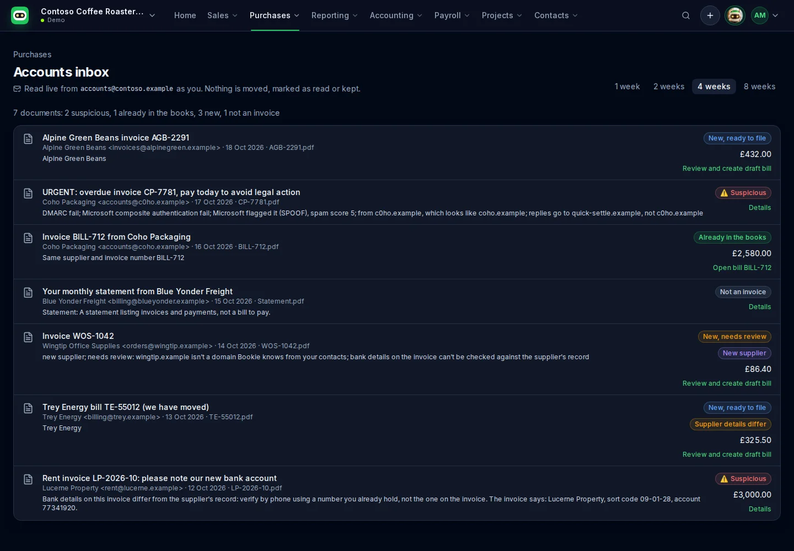

= Accounts inbox
:toc: left
:icons: font

*Purchases › Accounts inbox* reads the shared mailbox your suppliers send bills to (for example
`accounts@yourcompany.com`) and gives every PDF or image attached in the last few weeks a verdict.
It sits next to *Purchases › Inbox*, which shows Xero's own Files inbox.

It follows the same rules as the Bookie agent's bill-capture skill
(`agent/skills/bill-capture/SKILL.md`): check the email is genuine first, never guess a figure,
drafts only, and a person confirms every change to the books.

== Setting it up

. *Grant the permission.* Bookie's app registration asks for the delegated Microsoft Graph
  permission *Mail.Read.Shared* ("Read user and shared mail"). An administrator approves it once,
  for the organisation, through `getbook.ie/install` (or the self-hosted equivalent). Organisations
  that installed Bookie before this feature need to run the install again so the new permission is
  consented; people then sign out and in once so their token carries it.
. *Give people access to the mailbox.* Bookie reads the mailbox *as the signed-in person*, so each
  person who uses the page needs access to it in Microsoft 365 (Exchange admin centre › Mailboxes ›
  the shared mailbox › Delegation › *Read and manage (Full Access)*, or Read permission on its
  folders). Bookie can never open a mailbox the person couldn't open in Outlook.
. *Tell Bookie the address.* A member opens *Settings › Accounts inbox* and enters the mailbox
  address. It's kept with the other settings, sealed, in the organisation's own SharePoint. Until
  it's set, the page explains how to set it (and guests are asked to contact an administrator).

If the person can't open the mailbox (Graph answers 403 or 404) the page says so plainly, with
what to ask the administrator for.

=== Self-hosting: the app registration

Add *Microsoft Graph › Delegated › Mail.Read.Shared* to the app registration's API permissions
(Entra admin centre › App registrations › Bookie › API permissions › Add a permission). Bookie
redeems the user's refresh token for `https://graph.microsoft.com/.default`, so the token carries
every Graph permission the app registration has and the tenant has consented to; no code change
is needed beyond the registration. The calls are:

* `GET /users/{mailbox}/messages?$filter=receivedDateTime ge … and hasAttachments eq true`
  with `$select=…,internetMessageHeaders` and `$expand=attachments($select=id,name,contentType,size,isInline)`
* `GET /users/{mailbox}/messages/{id}` (re-read before any write)
* `GET /users/{mailbox}/messages/{id}/attachments/{attachmentId}/$value` (the file itself)

Nothing is ever sent, moved, flagged or marked as read.

== The verdicts

Each PDF, PNG or JPG attachment (not inline images, up to 10 MB) gets one of:

[cols="1,3"]
|===
| Verdict | When

| *Suspicious* | Any one of: DMARC `fail` or composite authentication `fail` in Exchange Online's
own `Authentication-Results` (authserv-id `mx.microsoft.com`; a header the sender added is
ignored); Microsoft flagged it (SCL 5 or more, or category PHSH, HPHSH, SPOOF, GIMP, UIMP, DIMP,
MALW); the sender's domain looks like a contact's or your own (swapped or added letters, `0` for
`o`, `rn` for `m`, a different TLD, extra words such as `-billing`); replies go to a different
domain; or the invoice's bank details differ from the supplier's record, or the record has none.
Bookie never reads a suspicious email's attachment (no extraction, no preview) and never offers to
file it.
| *Already in the books* | Matched to an existing bill for the same supplier by invoice number
(ignoring case, spaces, punctuation and leading zeros; the bill's number or reference), or by
total and date in the same, known currency. Links to the bill. Same supplier and number with a different total, date or
currency shows as *Different in the books*: check it, never add a second bill.
| *New* | Not in the books. Bookie proposes a draft bill from the document. *Ready to file* when
the email is authenticated from a known contact's domain and every required field was read with
confidence; otherwise *needs review*, with the reasons.
| *Not an invoice* | Statements, remittance advice, credit notes, receipts and anything else.
| *Couldn't read* | The document couldn't be read (for example the model isn't configured).
|===

The trust checks are `web/src/lib/mail/trust.ts`, a port of `agent/hermes/scripts/mail-trust.mjs`;
change both together.

== Reading the document

The attachment, and only the attachment, is sent to the portal's own Azure OpenAI deployment
(`AZURE_OPENAI_ENDPOINT`, `BOOKIE_CHAT_DEPLOYMENT`) with a strict JSON schema
(`web/src/lib/accounts-inbox/extraction.ts`). Nothing from Xero or Business Central is sent, so
Xero's rule against using its API data to train AI models doesn't come into it, and Azure OpenAI
neither keeps the request (`store: false`) nor trains on it.

The model copies fields exactly as printed and leaves anything it can't read as `null`. Bookie then:

* drops a date that isn't a full date, and a currency the document doesn't make clear (a bare `$`
  is not USD);
* marks *needs review* for a missing or uncertain supplier, invoice number, date, currency or total;
* checks the lines against the net, and net + VAT against the total, and flags a difference without
  changing either side;
* never chooses a tax rate or account: the person picks them in the editor;
* leaves out a line whose unit price isn't printed (rather than pricing it at 0) and says so.

What was read is cached in memory for ten minutes, keyed by tenant, user, mailbox and attachment, so
moving between the list and a document doesn't read it twice. Nothing is written to disk.

== The supplier

The supplier is taken from both sources, and each value keeps its source on screen: the invoice's
name, address, VAT number, company number, email, phone and bank details ("from the PDF"), and
the sender's address and domain ("from the sender"). Bookie matches a contact, strongest first:

. the VAT number (ignoring spaces and the country prefix);
. the sender's domain against the contact's email or website domain (never a webmail domain);
. the exact name (ignoring case, punctuation, "The" and Ltd/Limited and similar).

It shows why it matched. If several contacts match, or none does, it says so and never picks one.

* *Supplier details differ.* When the invoice prints a different address, email, phone or VAT
  number from the contact's record, a panel shows old → new per field with a tick box each. *Update
  supplier* asks for confirmation and then updates only the ticked fields through the connector
  (Xero `POST Contacts`; Business Central `PATCH vendors` with `addressLine1/2`, `city`, `state`,
  `postalCode`, `country`, `email`, `phoneNumber`, `taxRegistrationNumber`). Nothing is applied
  automatically. A printed street line replaces both street lines; any other part of the address
  the invoice doesn't print (country, say) keeps the record's value. In Xero the contact's other
  addresses and phone numbers (street address, mobile) are kept: Bookie changes the postal address
  and the default phone only.
* *Bank details are never proposed or applied from an invoice.* A changed or new bank account on
  an invoice is the classic invoice-fraud signal. Bookie compares the invoice's bank details with
  the record (Xero `BankAccountDetails`); a difference, or bank details when the record has none,
  makes the email *suspicious* with the warning "verify by phone using a number you already hold,
  not the one on the invoice", and there is no button to change them. Business Central's API
  doesn't expose vendor bank accounts, so there Bookie shows the invoice's bank details as a
  warning to check by phone.
* *New supplier.* With no match, Bookie proposes a new contact from the document (name, address,
  VAT number, email, phone; never bank details) with its own confirmation, before the bill.

== Creating the draft

*Review and create draft bill* opens the proposed bill in the usual editor beside the document.
The person checks it and chooses the accounts and tax rates; *Save as draft* asks for
confirmation, then the server re-reads the email from the mailbox, re-runs every check (a
suspicious email, or one already in the books, is refused whatever the browser sends), creates a
*DRAFT* bill through the connector and attaches the original file. If the file can't be attached,
the draft is deleted again so a retry won't duplicate it. Bookie never approves it.

== Demo

With `BOOKIE_DEV_AUTH=demo` the page reads a fictional mailbox (`accounts@contoso.example`,
`web/src/lib/mail/demo.ts`) with a lookalike phishing invoice, an invoice already in the books, a
new invoice, a new supplier, a statement, a supplier whose address changed and one whose bank
details changed. The demo has no model: each fixture carries what its document prints.
