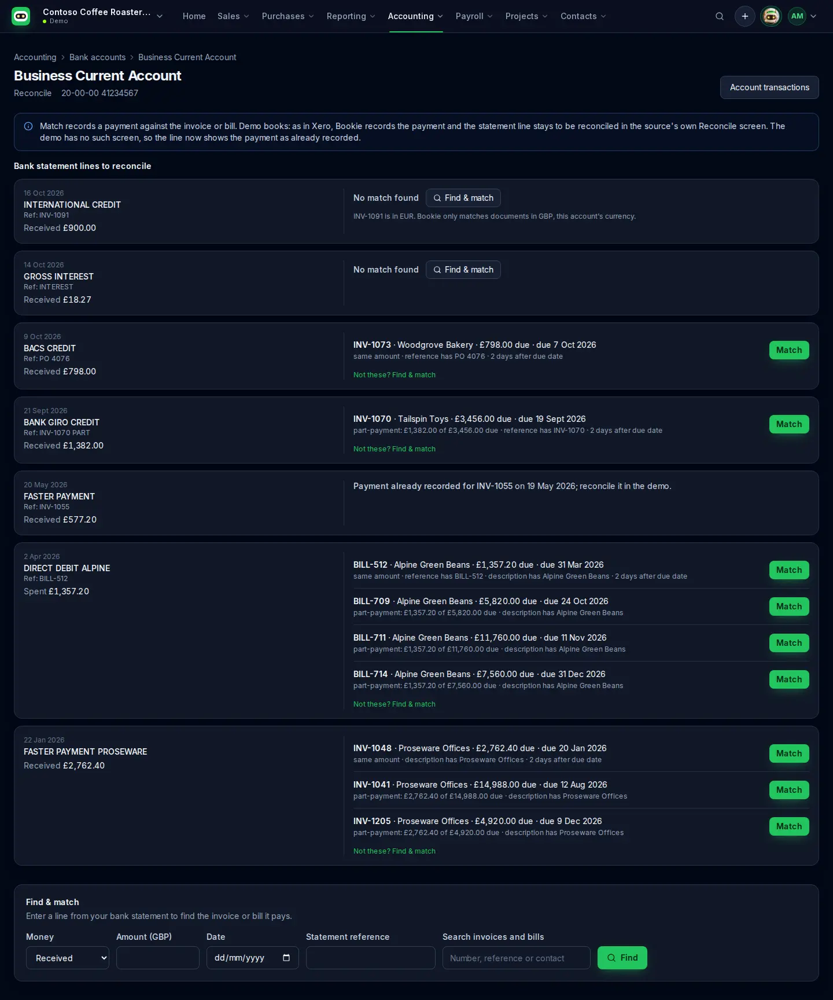

= Reconcile: matching bank lines to invoices and bills
:toc: left
:icons: font

A bank account's *Reconcile* page (Accounting › Bank accounts › an account › *Reconcile*) proposes,
for each unreconciled bank statement line, the open invoice or bill it probably pays, and records
the payment when the person confirms. Bookie never reconciles a statement line itself: neither
Xero's nor Business Central's API can. The page says plainly what is left to do in the source.

_Demo organisation only (`BOOKIE_DEV_AUTH=demo`): every name and amount is fictional._

== What each source allows

[cols="1,3,3",options="header"]
|===
| | Xero | Business Central

| Statement lines (the bank feed)
| Not available. The Accounting API has no statement lines; `Reports/BankStatement` answers 401 to
  Bookie's connection, and the Finance API's `BankStatementsPlus` is restricted to approved lending
  partners.
| Not available. API v2.0 has no bank statement, bank account reconciliation or payment
  reconciliation journal entity. For banking it has only `bankAccounts`, `journals`/`journalLines`,
  and the customer and vendor payment journals (`customerPaymentJournals`, `vendorPaymentJournals`)
  with their lines (`customerPayments`, `vendorPayments`).

| Record the payment
| `PUT /Payments` against the invoice or bill, from the bank account, for the line's amount and date.
| With the Bookie BC extension, customer payments are registered and posted to a local-currency
  bank account (`paymentRegistrations`). Bills are paid in Business Central with a payment journal.
  Without the extension, the API's payment journal lines balance against the journal batch's own
  account (not a bank account chosen per payment), and posting posts every line in the batch, so
  Bookie doesn't record payments there.

| Reconcile the statement line
| Not through the API. `IsReconciled: true` on a new payment only flags it; it isn't matched to the
  feed line, which would stay in Reconcile, so Bookie never sets it. After the payment is recorded,
  Xero offers it as the suggested match for the statement line in its own Reconcile screen: open it
  there and click OK. The page links to Xero's Reconcile screen for the account.
| Not through the API. Import the bank statement in *Bank Account Reconciliation* (or a *Payment
  Reconciliation Journal*), match the new bank ledger entry and post the reconciliation. The page
  links to the Bank Account Reconciliations list for the account.
|===

Because neither API shares statement lines, on Xero and Business Central the page offers *Find &
match*: enter a line from the bank statement (money in or out, amount, date, reference) and Bookie
ranks the open invoices or bills it could pay. The demo organisations have a fictional bank feed so
every case can be seen and tested. A source whose API does share statement lines implements
`BankModule.statementLines`; the page then lists them with suggestions.

== How a match is suggested

The matcher is a pure module, `web/src/lib/reconcile/match.ts`, unit-tested in `match.test.ts`.

* *Candidates:* sales invoices awaiting payment for money in, bills awaiting payment for money out,
  in the same currency as the bank account. The latest 100 of each are compared; Find & match
  searches the rest by number, reference or contact.
* *Clues*, shown as plain reasons rather than a score, for example
  "same amount · reference has INV-0042 · 2 days after due date":
** the amount: the same as the amount still due, or a *part-payment* when the line is smaller
   (a line bigger than the amount due is never a candidate);
** the invoice number, or the customer's own reference, in the line's reference or description
   (ignoring spaces, dashes and case; an all-digit number must appear as a whole word of at least
   four digits, so it doesn't match inside a sort code or card number);
** the contact's name (its first distinctive word, which is what the reason names) in the line;
** the date: from a few days before the invoice date to 60 days after the due date.
* A candidate is suggested on an exact amount alone, on the invoice number alone, or on two weaker
  clues together. Several candidates are listed best first; none gives *No match found* and *Find &
  match*.
* One line is matched to one invoice or bill. A line that pays several documents at once can't be
  matched here yet; Find & match says no single document has that much due.

== Never guessing

* *Currency:* an invoice or bill in another currency is never suggested. If the line names one, the
  page says so ("INV-1091 is in EUR. Bookie only matches documents in GBP, this account's currency").
  If the account's currency isn't known, nothing is compared.
* *Unknown amount due* (for example Business Central bills without the Bookie BC extension): never
  treated as zero or as the full total. The candidate can still appear on its number or contact,
  marked "amount due not available from Business Central", without *Match*.
* *Already recorded:* an unreconciled entry in the books for the same amount and direction within
  a week of a statement line (a payment, or spend or receive money) is that line: it says "Payment
  already recorded for INV-0042; reconcile it in Xero" and *Match* isn't offered. Each entry
  explains one line, going first to the line that names its document. For a line typed into Find &
  match, such an entry is shown as a warning, and *Match* asks the person to confirm it is a
  different payment.
* *Never twice on one document:* whatever the page showed, the server refuses a payment when the
  invoice or bill already has a payment of that amount within a week of the line, reconciled or
  not.
* If the account's transactions can't all be read (an error, or more than one page of them),
  Bookie says it can't check and doesn't offer *Match*.

== Matching

*Match* opens a confirmation that states the payment (amount, document, bank account, date) and
what will still need doing in the source. On confirm, the `matchBankLine` server action
(`web/src/lib/portal/actions/reconcile.ts`) re-resolves the organisation and re-reads a statement
line from the source rather than trusting the request. It then re-checks the direction, the
currency, that the amount due is still what the page showed (so a second tab or another person
can't pay it twice), and that nothing is already recorded. Finally it records the payment through
`recordPayment`, which re-reads the invoice or bill and refuses more than the amount due.

== For Bookie the agent

The matcher has no portal or connector imports, so the agent can use the same logic to answer
"what does this bank line pay?" (follow-up).
